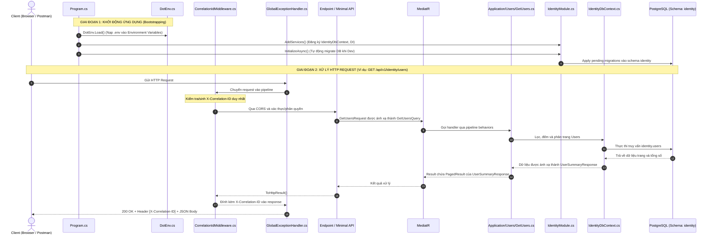

# Tài Liệu Chi Tiết Luồng Thực Thi Mã Nguồn (Codebase Runtime & Execution Flow)

> **Cập nhật triển khai 23/09/2026:** Các ví dụ direct-DbContext phía dưới mô tả bản khung cũ. Luồng hiện tại: `DotEnv` → đăng ký JWT/validation/module → migrate Identity + Catalog ở Development → exception/correlation/CORS/authentication/authorization/rate limiter → endpoint. Identity gọi MediatR handler; Catalog gọi `CatalogService`. Validation dự kiến trả `Result`/`ValidationError`, không ném `ValidationException`. API users quản trị yêu cầu role `Admin`; JWT được kiểm tra trạng thái tài khoản và security stamp. Chi tiết trạng thái đã/chưa làm: [backend-progress.md](backend-progress.md).

Tài liệu này giải thích chi tiết **vòng đời khởi động (Bootstrapping)** và **luồng xử lý một HTTP Request (Request Lifecycle)** qua từng file code trong hệ thống **SkillBridge API**.  
Mục đích: Giúp các lập trình viên mới vào dự án có thể đọc hiểu chính xác code chạy từ đâu, qua những middleware nào, và xử lý dữ liệu ra sao.

---

## 1. Bức Tranh Tổng Thể (Architectural Sequence)



---

## 2. Giai đoạn 1: Khởi động Ứng dụng (Bootstrapping Flow)

Toàn bộ quá trình khởi động bắt đầu từ file:  
👉 **[src/Api/Program.cs](file:///d:/Projects/skillbridge-api/src/Api/Program.cs)**

### Bước 1: Tự động nạp file `.env`

- **File thực thi**: [src/Api/Common/DotEnv.cs](file:///d:/Projects/skillbridge-api/src/Api/Common/DotEnv.cs)
- **Hành động**: `DotEnv.Load()` được gọi ở dòng đầu tiên của `Program.cs`.
    - Nó bắt đầu từ thư mục hiện tại, duyệt ngược lên các thư mục cha cho đến khi tìm thấy file `.env`.
    - Đọc các dòng cấu hình (như `ConnectionStrings__Database=...`, `RabbitMq__Host=...`) và gán vào biến môi trường hệ thống `Environment.SetEnvironmentVariable(...)`.
    - Nhờ đó, lập trình viên không cần cài đặt biến môi trường thủ công trên hệ điều hành.

### Bước 2: Khởi tạo Host & Cấu hình dịch vụ nền tảng

- **Dòng code**: `var builder = WebApplication.CreateBuilder(args);`
    - ASP.NET Core tự động đọc toàn bộ cấu hình từ `appsettings.json`, `appsettings.Development.json` và các biến môi trường vừa được `DotEnv` nạp.
- **Các dịch vụ toàn cục được nạp qua `AddApiServices` trong [ApiServiceCollectionExtensions.cs](../src/Api/Extensions/ApiServiceCollectionExtensions.cs)**:
    - `builder.Services.AddProblemDetails()`: Kích hoạt chuẩn RFC 7807 cho lỗi API.
    - `builder.Services.AddExceptionHandler<GlobalExceptionHandler>()`: Đăng ký bộ bắt ngoại lệ tập trung ([GlobalExceptionHandler.cs](file:///d:/Projects/skillbridge-api/src/Api/Middleware/GlobalExceptionHandler.cs)).
    - `builder.Services.AddOpenApi()`: Sinh tài liệu OpenAPI cho toàn bộ endpoint.
    - `builder.Services.AddCors(...)`: Cấu hình danh sách tên miền được phép gọi API (`Cors:AllowedOrigins`).
    - `builder.Services.AddHealthChecks()`: Tạo health check probe phục vụ Docker/Kubernetes.

### Bước 3: Đăng ký Bối cảnh Bảo mật & Enterprise BuildingBlocks

- **Dòng code**:

    ```csharp
    var modules = ModuleRegistry.Create();
    builder.Services.AddApiServices(builder.Configuration, modules);
    ```

- **Hành động**: [ModuleRegistry.cs](../src/Api/Modules/ModuleRegistry.cs) chứa danh sách 10 module theo thứ tự hiện tại. `AddApiServices` ghép các phần sau:
    - `AddBuildingBlocks`:
        - Đăng ký `TimeProvider.System` chuẩn hóa thời gian.
        - Đăng ký `MediatR` quét toàn bộ Handler trong 10 assemblies module.
        - Kích hoạt `LoggingBehavior` (đo hiệu năng) và `ValidationBehavior` (tự động chạy FluentValidation trước khi vào Handler).
        - Đăng ký `IEventBus` -> `InMemoryEventBus` cho giao tiếp phi đồng bộ liên module.
        - Đăng ký `AuditInterceptor` và `DispatchDomainEventsInterceptor` cho EF Core.
    - `AddSecurityServices`: Đăng ký `JwtSettings`, `IPasswordHasher`/`PasswordHasher` và `IJwtTokenGenerator`/`JwtTokenGenerator` trong `BuildingBlocks.Security`.
    - `AddApiAuthentication`: Cấu hình JWT Bearer, phân quyền, `IHttpContextAccessor` và `ICurrentUser`/`CurrentUser` trong API. Các file triển khai nằm tại [AuthenticationExtensions.cs](../src/Api/Security/AuthenticationExtensions.cs) và [CurrentUser.cs](../src/Api/Security/CurrentUser.cs).

### Bước 4: Đăng ký Dependency Injection cho từng Module

- **Dòng code bên trong `AddApiServices`**:
    ```csharp
    foreach (var module in modules)
    {
        module.AddServices(services, configuration);
    }
    ```
- **Hành động**: Mỗi module độc lập đăng ký DbContext và services của riêng mình trong IoC Container mà không dính líu đến module khác.

### Bước 5: Xây dựng HTTP Middleware Pipeline

- **Dòng code**: `var app = builder.Build();`
- **`app.UseApiPipeline()` trong [ApiApplicationExtensions.cs](../src/Api/Extensions/ApiApplicationExtensions.cs) ghép middleware theo thứ tự**:
    1. `app.UseExceptionHandler()`: Lớp bọc ngoài cùng. Bắt mọi exception (kể cả `ValidationException` từ FluentValidation) và chuyển cho `GlobalExceptionHandler`.
    2. `app.UseMiddleware<CorrelationIdMiddleware>()`: Gán mã định danh duy nhất cho request (`X-Correlation-ID`).
    3. `app.UseCors("Default")`: Kiểm tra chính sách CORS.
    4. `app.UseAuthentication()`: Xác thực JWT và thiết lập danh tính người dùng.
    5. `app.UseAuthorization()`: Áp dụng yêu cầu phân quyền của endpoint.
    6. Nếu ở môi trường `Development`:
        - `MapApiDocumentation()` trong [HostEndpoints.cs](../src/Api/Endpoints/HostEndpoints.cs) bật OpenAPI và Scalar.
        - `Program.cs` gọi `InitializeModulesAsync(modules)`, lặp qua từng module và gọi `InitializeAsync(app.Services)` để tự kiểm tra/migrate DB.

### Bước 6: Map Endpoints của từng Module & Lắng nghe Request

- **Dòng code**:
    ```csharp
    app.MapHostEndpoints(modules);
    app.MapModuleEndpoints(modules);
    app.Run();
    ```
- `MapHostEndpoints` đăng ký root, `/health/live` và `/health/ready`. `MapModuleEndpoints` gọi từng module tự đăng ký Minimal API:
    - Base class [ModuleDefinition.cs](file:///d:/Projects/skillbridge-api/src/BuildingBlocks/Modules/ModuleDefinition.cs) tạo sẵn endpoint probe: `GET /api/v1/{routePrefix}/_module`.
    - [IdentityModule.cs](file:///d:/Projects/skillbridge-api/src/Modules/Identity/IdentityModule.cs) đăng ký thêm:
        - `GET /api/v1/identity/users/me`
        - `GET /api/v1/identity/users`

---

## 3. Giai đoạn 2: Luồng Xử lý một HTTP Request (Request Execution Flow)

Giả sử Client gửi một request:  
👉 **`GET http://localhost:5000/api/v1/identity/users`**

### 1. Request đi vào `CorrelationIdMiddleware`

- **File**: [src/Api/Middleware/CorrelationIdMiddleware.cs](file:///d:/Projects/skillbridge-api/src/Api/Middleware/CorrelationIdMiddleware.cs)
- **Logic**:
    - Middleware kiểm tra xem Client có gửi kèm header `X-Correlation-ID` hay không.
    - Nếu không có: Sinh một GUID ngẫu nhiên không có dấu gạch ngang (ví dụ: `a1b2c3d4e5...`) và gán vào `context.Request.Headers["X-Correlation-ID"]`.
    - Đăng ký callback `context.Response.OnStarting`: đảm bảo trước khi gửi response về client, Response Header cũng sẽ có `X-Correlation-ID: a1b2c3d4e5...`.
    - Chuyển quyền xử lý cho middleware tiếp theo (`await _next(context)`).

### 2. Request đi qua `GlobalExceptionHandler`

- **File**: [src/Api/Middleware/GlobalExceptionHandler.cs](file:///d:/Projects/skillbridge-api/src/Api/Middleware/GlobalExceptionHandler.cs)
- **Logic**:
    - Đóng vai trò là chốt chặn bảo vệ cuối cùng.
    - Nếu toàn bộ luồng xử lý bên trong chạy bình thường: Nó không can thiệp.
    - Nếu có unhandled Exception xảy ra:
        - Ghi log lỗi ra console/file kèm theo Correlation ID.
        - Tạo object `ProblemDetails` theo chuẩn RFC 7807 (gồm status code 500, title "Server Error", path và extension `correlationId`).
        - Trả về JSON cho client mà không để lộ stack trace nhạy cảm của hệ thống.

### 3. Request đến Endpoint Delegate (Minimal API)

- **File**: [UsersEndpoints.cs](../src/Modules/Identity/Endpoints/UsersEndpoints.cs)
- **Đoạn code thực thi**:

    ```csharp
    group.MapGet("/", async ([AsParameters] GetUsersRequest request, ISender sender) =>
    {
        var query = new GetUsersQuery(
            PageNumber: request.Page ?? 1,
            PageSize: request.PageSize ?? 20,
            SearchTerm: request.Search,
            Role: request.Role,
            IsActive: request.IsActive);

        var result = await sender.Send(query);
        return result.ToHttpResult();
    })
    .RequireAuthorization();
    ```

- **Các bước chi tiết**:
    1. ASP.NET Core Router phân giải đường dẫn khớp với template `/api/v1/identity/users`.
    2. Endpoint bind query parameters vào [GetUsersRequest.cs](../src/Modules/Identity/Application/Users/DTOs/Requests/GetUsersRequest.cs), tạo `GetUsersQuery` và gửi qua `ISender`.
    3. MediatR chạy pipeline behaviors trong `BuildingBlocks/Messaging/Behaviors/`, sau đó gọi handler trong [GetUsers.cs](../src/Modules/Identity/Application/Users/GetUsers.cs).
    4. Handler dùng [IdentityDbContext.cs](../src/Modules/Identity/Infrastructure/Persistence/IdentityDbContext.cs) và [UserConfiguration.cs](../src/Modules/Identity/Infrastructure/Persistence/Configurations/UserConfiguration.cs) để lọc, đếm và phân trang `identity.users`.
    5. Kết quả là `Result<PagedResult<UserSummaryResponse>>`; endpoint ánh xạ sang `UsersResponse` để giữ JSON phân trang với trường `page`. Nhóm `Auth` áp dụng cùng cách tổ chức use case, Requests và Responses riêng.

### 4. Phản hồi trả về Client

- Response đi ngược qua các middleware.
- `CorrelationIdMiddleware` gắn header `X-Correlation-ID: a1b2c3d4...`.
- Client nhận được:
    - **HTTP Status**: `200 OK`
    - **Headers**: `Content-Type: application/json`, `X-Correlation-ID: ...`
    - **Body**: JSON phân trang chứa các `UserSummaryResponse` và thông tin trang/tổng số.

---

## 4. Tóm tắt Vai Trò của Từng File Code Trong Hệ Thống

| Đường dẫn File                                                       | Tầng             | Vai trò chính                                                                                                                                                           |
| :------------------------------------------------------------------- | :--------------- | :---------------------------------------------------------------------------------------------------------------------------------------------------------------------- |
| **`Program.cs`**                                                     | `Api`   | Ghép các bước khởi động, chỉ gọi initialization module trong Development. |
| **`Modules/ModuleRegistry.cs`**                                      | `Api` | Danh sách 10 module, vòng đời initialization và mapping endpoints. |
| **`Extensions/ApiServiceCollectionExtensions.cs`**                  | `Api` | Đăng ký services, CORS, health, BuildingBlocks, security và module services. |
| **`Extensions/ApiApplicationExtensions.cs`**                         | `Api` | Ghép HTTP middleware theo thứ tự hiện tại. |
| **`Endpoints/HostEndpoints.cs`**                                     | `Api` | Root, health và tài liệu API trong Development. |
| **`Common/DotEnv.cs`**                                               | `Bootstrapper`   | Bộ quét và nạp file `.env` cục bộ vào biến môi trường hệ thống.                                                                                                         |
| **[`Security/CurrentUser.cs`](../src/Api/Security/CurrentUser.cs)**    | `Api`            | Triển khai `ICurrentUser` lấy UserId, Email, Role từ `IHttpContextAccessor`.                                                                                            |
| **[`Security/AuthenticationExtensions.cs`](../src/Api/Security/AuthenticationExtensions.cs)** | `Api` | `AddApiAuthentication` cấu hình JWT Bearer, phân quyền và đăng ký bối cảnh người dùng HTTP. |
| **`Middleware/CorrelationIdMiddleware.cs`**                          | `Bootstrapper`   | Tạo và truyền mã `X-Correlation-ID` xuyên suốt request/response để truy vết log.                                                                                        |
| **`Middleware/GlobalExceptionHandler.cs`**                           | `Bootstrapper`   | Bắt ngoại lệ tập trung, xử lý `ValidationException` và lỗi 500 chuẩn RFC 7807 `ProblemDetails`.                                                                         |
| **`Modules/IModule.cs` & `ModuleDefinition.cs`**                   | `BuildingBlocks` | Hợp đồng vòng đời module (`AddServices`, `MapEndpoints`, `InitializeAsync`) và endpoint probe `/_module`.                                                               |
| **`Messaging/CQRS/ICommand.cs` & `IQuery.cs`**                       | `BuildingBlocks` | Giao diện Command/Query chuẩn hóa CQRS gắn liền với Railway `Result` / `Result<T>`.                                                                                     |
| **`Messaging/Behaviors/ValidationBehavior.cs`**                      | `BuildingBlocks` | MediatR pipeline tự động chạy FluentValidation trước khi gọi Handler.                                                                                                   |
| **`Messaging/Behaviors/LoggingBehavior.cs`**                         | `BuildingBlocks` | MediatR pipeline đo thời gian thực thi, cảnh báo request chạy chậm (> 500ms).                                                                                           |
| **`Security/ICurrentUser.cs`**                                       | `BuildingBlocks` | Hợp đồng lấy bối cảnh người dùng đăng nhập không phụ thuộc `HttpContext`.                                                                                               |
| **`Security/SecurityExtensions.cs`**                                | `BuildingBlocks` | `AddSecurityServices` đăng ký JWT settings, dịch vụ cấp token và hash mật khẩu dùng chung. |
| **`Domain/Entity.cs` & `AggregateRoot.cs`**                          | `BuildingBlocks` | Lớp cơ sở DDD: so sánh định danh Id và thu thập sự kiện miền `DomainEvents`.                                                                                            |
| **`Domain/AuditableEntity.cs`**                                      | `BuildingBlocks` | Base Entity hỗ trợ audit (`CreatedAt`, `CreatedBy`, `UpdatedAt`, `UpdatedBy`) và xóa mềm.                                                                               |
| **`Persistence/Interceptors/AuditInterceptor.cs`**                | `BuildingBlocks` | EF Core interceptor tự động điền thời gian UTC và UserId khi `SaveChanges`.                                                                                             |
| **`Persistence/Interceptors/DispatchDomainEventsInterceptor.cs`** | `BuildingBlocks` | EF Core interceptor tự động thu thập và phát domain events qua MediatR.                                                                                                 |
| **`Messaging/Events/IIntegrationEvent.cs` & `IEventBus.cs`**         | `BuildingBlocks` | Hợp đồng giao tiếp bất đồng bộ liên module (hiện thực in-memory hoặc message broker).                                                                                   |
| **`Results/Pagination/PagedResult.cs`**                              | `BuildingBlocks` | Đối tượng phản hồi phân trang chuẩn thống nhất format JSON cho cả 10 modules. |
| **`Results/Result.cs` & `Http/ResultExtensions.cs`**                  | `BuildingBlocks` | Result/Error giữ kết quả xử lý; Http chứa helper chuyển đổi sang Minimal API IResult. |
| **`BuildingBlocksExtensions.cs`**                         | `BuildingBlocks` | Extension method đăng ký tập trung toàn bộ MediatR, FluentValidation, Interceptors, EventBus.                                                                           |
| **`src/Modules/*/{Name}Module.cs`**                                  | `Modules`        | Triển khai 10 Bounded Contexts độc lập (`Identity`, `Profiles`, `Catalog`, `Scheduling`, `Booking`, `Payments`, `Learning`, `Messaging`, `Reviews`, `Recommendations`). |
| **`Directory.Build.props` & `Directory.Packages.props`**             | `Solution` | Cấu hình C# và phiên bản NuGet dùng chung cho toàn bộ project. |
