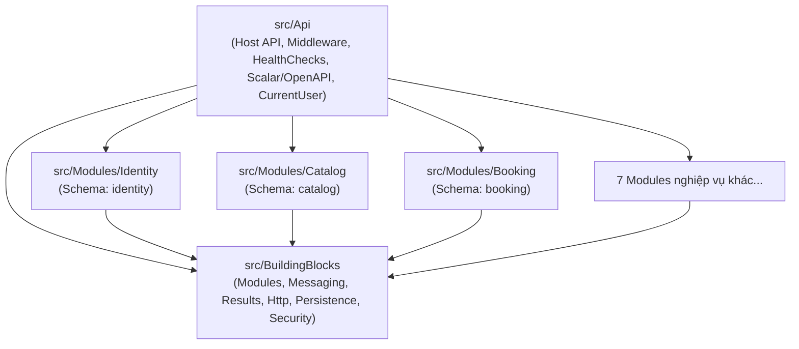

# Tài Liệu Hướng Dẫn Cài Đặt & Phát Triển (Setup & Developer Guide)

Tài liệu này dành cho tất cả thành viên (Developers, QA, DevOps) tham gia phát triển dự án **SkillBridge API**.  
Dự án được xây dựng theo mô hình **Modular Monolith** trên nền tảng **.NET 10** kết hợp phương pháp **Domain-Driven Design (DDD)**.

---

## Mục lục

1. [Tổng quan kiến trúc Modular Monolith](#1-tổng-quan-kiến-trúc-modular-monolith)
2. [Yêu cầu môi trường cài đặt (Prerequisites)](#2-yêu-cầu-môi-trường-cài-đặt-prerequisites)
3. [Khởi động hạ tầng cục bộ với Docker Compose](#3-khởi-động-hạ-tầng-cục-bộ-với-docker-compose)
4. [Cấu hình ứng dụng](#4-cấu-hình-ứng-dụng)
5. [Biên dịch và Chạy ứng dụng API](#5-biên-dịch-và-chạy-ứng-dụng-api)
6. [Tài liệu API tương tác & Kiểm thử nhanh](#6-tài-liệu-api-tương-tác--kiểm-thử-nhanh)
7. [Quy chuẩn Code & Quy trình CI trước khi tạo Pull Request](#7-quy-chuẩn-code--quy-trình-ci-trước-khi-tạo-pull-request)
8. [Hướng dẫn chi tiết: Thêm một Module mới](#8-hướng-dẫn-chi-tiết-thêm-một-module-mới)

---

## 1. Tổng quan kiến trúc Modular Monolith

Hệ thống được đóng gói triển khai dưới dạng **một tiến trình (Single Process)** nhưng mã nguồn được chia thành các Bounded Context (Module nghiệp vụ) hoàn toàn độc lập:



### Các trụ cột Enterprise trong `BuildingBlocks`:

1. **Modules**: `IModule` và `ModuleDefinition` đóng gói trọn vẹn vòng đời và probe endpoint của từng module.
2. **Messaging/CQRS**: `ICommand`, `IQuery`, `ICommandHandler`, `IQueryHandler` tích hợp sẵn Railway `Result<T>`.
3. **Messaging/Behaviors**: `ValidationBehavior` (tự động chạy FluentValidation) và `LoggingBehavior` (đo lường hiệu năng).
4. **Security**: `BuildingBlocks.Security` chứa `JwtSettings`, các hợp đồng và triển khai cấp JWT/hash mật khẩu, cùng `ICurrentUser`. `Api/Security` cấu hình JWT Bearer, phân quyền và triển khai `CurrentUser` đọc danh tính từ HTTP.
5. **Persistence/Interceptors**: `AuditInterceptor` (gán thời gian/người tạo/sửa, chuyển xóa mềm) và `DispatchDomainEventsInterceptor` (gom và phát domain events).
6. **Messaging/Events & Outbox**: Các hợp đồng integration event, event bus và kiểu dữ liệu outbox. DI hiện đăng ký `InMemoryEventBus`.
7. **Results/Pagination và Http**: `PaginationParams` và `PagedResult<T>` thống nhất dữ liệu phân trang; `Http/ResultExtensions.cs` ánh xạ `Result` sang HTTP response.

`Program.cs` lấy danh sách từ `ModuleRegistry.Create()` rồi gọi `AddApiServices(configuration, modules)`. Phương thức này ghép BuildingBlocks, `AddSecurityServices`, `AddApiAuthentication` và dịch vụ từng module. Danh sách 10 module nằm tại `src/Api/Modules/ModuleRegistry.cs`; xem [cấu trúc toàn backend](backend-structure.md).

Tất cả project kế thừa cấu hình C# từ `Directory.Build.props`. Phiên bản NuGet nằm trong `Directory.Packages.props`; khi thêm dependency, khai báo `PackageReference` tại project sử dụng và không ghi `Version` trong `.csproj`. Module có persistence PostgreSQL tự thêm `<PackageReference Include="Npgsql.EntityFrameworkCore.PostgreSQL" />`.

### 3 Nguyên tắc bất biến (Golden Rules):

1. **Tuyệt đối không reference chéo giữa các Module**: Module `Booking` không được phép thêm project reference đến Module `Identity` hay `Catalog`.
2. **Cô lập dữ liệu (Schema Isolation)**: Mỗi module sở hữu riêng một PostgreSQL schema (ví dụ: `identity.users`, `booking.appointments`). Module này không được đọc/ghi trực tiếp vào schema của module khác.
3. **Giao tiếp liên module**:
    - Truy vấn đồng bộ (Sync): Sử dụng In-Memory Dispatcher hoặc Public Contracts interface.
    - Luồng nghiệp vụ bất đồng bộ (Async): Hiện dùng `InMemoryEventBus`; RabbitMQ và Transactional Outbox là hướng tích hợp tiếp theo.

---

## 2. Yêu cầu môi trường cài đặt (Prerequisites)

Trước khi bắt đầu, đảm bảo máy bạn đã cài đặt:

- **.NET 10 SDK** (phiên bản `10.0.x` - kiểm tra bằng `dotnet --version`).
- **Docker Desktop** (hoặc Docker Engine + Docker Compose) để chạy PostgreSQL và Redis local.
- **IDE khuyên dùng**:
    - Visual Studio 2022 (v17.12 trở lên)
    - VS Code (cài extension _C# Dev Kit_)
    - JetBrains Rider

---

## 3. Khởi động hạ tầng cục bộ với Docker Compose

Khi chạy hoàn toàn local, dùng `skillbridge-infra/compose.yaml`. Bắt đầu Docker Desktop, rồi từ thư mục gốc repo API chạy:

Bootstrap SQL trong repo infra chỉ chạy khi khởi tạo volume PostgreSQL mới, tạo extension và schema; không tạo bảng hoặc seed role. Bảng của module đã có code được quản lý bằng EF migrations. [database-blueprint.sql](database-blueprint.sql) là bản thiết kế tham khảo, không chạy kèm bootstrap/EF để tạo cùng các bảng.

Thay bootstrap không thay đổi hoặc khởi tạo lại volume hiện có. Database từng dùng blueprint `snake_case` cần [đối chiếu schema/dữ liệu riêng](database-migrations.md#nguồn-quản-lý-schema-và-bootstrap); migration mới không tự chuyển cấu trúc đó. Không dùng `docker compose down -v` để sửa lệch schema nếu còn dữ liệu cần giữ.

```powershell
Set-Location ../skillbridge-infra
.\scripts\start.ps1
Set-Location ../skillbridge-api
```

Mặc định chỉ chạy PostgreSQL và Redis. Nếu dùng PostgreSQL development chung của nhóm, chỉ chạy `docker compose up -d redis` trong repo infra và cấu hình chuỗi kết nối DB được cấp qua SSH tunnel/mạng riêng. Nếu cần RabbitMQ/MinIO local để phát triển tích hợp, chạy `./scripts/start.ps1 -Optional` trong repo infra. Không chạy đồng thời Compose cũ của repo API vì trùng cổng.

### Dịch vụ & cổng truy cập:

| Dịch vụ | Cổng local | Cấu hình mẫu trong repo infra | Bật mặc định |
| --- | --- | --- | --- |
| PostgreSQL 17 | `5432` | DB/user `skillbridge`, password `skillbridge_dev_only` | Có |
| Redis 7.4 | `6379` | Password `skillbridge_dev_only` | Có |
| RabbitMQ / MinIO | `5672`, `15672` / `9000`, `9001` | Xem `.env.example` của repo infra | Tùy chọn |

### Các lệnh quản lý Docker hữu ích:

```powershell
# Xem trạng thái các container đang chạy
Set-Location ../skillbridge-infra
docker compose ps

# Xem log các dịch vụ
docker compose logs -f

# Dừng toàn bộ dịch vụ (giữ lại dữ liệu volume)
docker compose down
Set-Location ../skillbridge-api
```

---

## 4. Cấu hình ứng dụng

Credential JWT, database và Redis được nạp từ `.env` hoặc biến môi trường triển khai. `appsettings*.json` không chứa credential và Identity không còn chuỗi kết nối dự phòng. Cần điền `ConnectionStrings__Database` và `Redis__ConnectionString` theo `skillbridge-infra/.env`. Với file mẫu infra mới tạo, hai dòng tương ứng trong `.env` của API là:

```dotenv
ConnectionStrings__Database=Host=localhost;Port=5432;Database=skillbridge;Username=skillbridge;Password=skillbridge_dev_only
Redis__ConnectionString=localhost:6379,password=skillbridge_dev_only
```

`.env.example` của API còn phục vụ Compose cũ nên có mật khẩu khác; không dùng nguyên mẫu đó khi chạy infra repo. Không ghi đè `.env` đã có trên máy.

Cấu hình phụ thuộc môi trường cũng nằm trong `.env`/biến môi trường:

| Biến | Mục đích |
| --- | --- |
| `Cors__AllowedOrigins__0`, `Cors__AllowedOrigins__1` | Các frontend origin được gọi API, gồm scheme/host/port; thêm origin bằng chỉ số tiếp theo. Khi triển khai, đặt đúng origin thực tế. |
| `AllowedHosts` | Danh sách host HTTP được chấp nhận, phân cách bằng dấu `;`; môi trường triển khai cần giới hạn theo domain thực tế. |
| `RabbitMq__Host`, `RabbitMq__Username`, `RabbitMq__Password` | Chỉ cần khi phát triển tích hợp broker; API hiện dùng `InMemoryEventBus`. |

`AllowedHosts` không đặt địa chỉ lắng nghe của API; các profile/cổng trong `launchSettings.json` vẫn là cấu hình IDE. JWT issuer/audience và thời hạn token tiếp tục là mặc định logic trong JSON.

`Jwt__SecretKey` trong `.env.example` cố ý để trống. Key thật chỉ đặt trong `.env` được Git/Docker bỏ qua hoặc biến môi trường triển khai; dùng bộ sinh ngẫu nhiên mật mã, tối thiểu 32 byte UTF-8. API dừng khởi động nếu thiếu key hoặc key ngắn hơn mức này.

Workspace local được chuẩn hóa trong lần rà soát ngày 2026-10-17 đã có `.env` với key ngẫu nhiên mới. **Giữ nguyên file đó khi chạy lại**. Với checkout mới chưa có `.env`, chạy tại thư mục gốc để sao chép mẫu, sinh 64 byte ngẫu nhiên và ghi đúng một dòng key mà không in giá trị ra màn hình:

```powershell
if (Test-Path -LiteralPath .env) {
    throw '.env already exists; keep its configured values.'
}

Copy-Item -LiteralPath .env.example -Destination .env
$jwtBytes = [byte[]]::new(64)
$jwtRandom = [System.Security.Cryptography.RandomNumberGenerator]::Create()
try {
    $jwtRandom.GetBytes($jwtBytes)
}
finally {
    $jwtRandom.Dispose()
}
$jwtValue = [Convert]::ToBase64String($jwtBytes)
$envLines = @(Get-Content -LiteralPath .env | Where-Object {
    $_ -notmatch '^\s*Jwt__SecretKey\s*='
})
$envLines += "Jwt__SecretKey=$jwtValue"
[System.IO.File]::WriteAllLines(
    (Join-Path (Get-Location).Path '.env'),
    $envLines,
    [System.Text.UTF8Encoding]::new($false)
)
Remove-Variable jwtBytes, jwtRandom, jwtValue, envLines
```

Kiểm tra thông tin kết nối DB/Redis trong file mới theo hạ tầng local. Mỗi môi trường triển khai phải cấp secret riêng qua biến môi trường; không dùng chung key local. Biến môi trường của tiến trình được ưu tiên hơn `.env`. Sau khi đổi key, khởi động lại API; access token ký bằng key cũ sẽ không còn hợp lệ. Việc đổi key không tự thu hồi refresh token hoặc đổi mật khẩu DB. Xem [báo cáo bảo mật](security-review.md) về các phần còn cần xử lý.

---

## 5. Biên dịch và Chạy ứng dụng API

Mở terminal tại thư mục gốc của dự án:

Nếu database đã có dữ liệu, review [chuỗi migration và dữ liệu legacy](database-migrations.md) trước khi chạy API. Host Development vẫn tự áp dụng migration; các lệnh tạo migration/xuất SQL dùng design-time factory không khởi động host và không tự cập nhật database.

```powershell
# 1. Restore các package NuGet
dotnet restore

# 2. Biên dịch toàn bộ Solution
dotnet build

# 3. Khởi chạy dự án Host API
dotnet run --project src/Api
```

Sau khi chạy thành công, console sẽ hiển thị địa chỉ lắng nghe (mặc định: `http://localhost:5000` hoặc cổng theo `launchSettings.json`).

---

## 6. Tài liệu API tương tác & Kiểm thử nhanh

Khi ứng dụng chạy ở môi trường `Development`, bạn có thể truy cập các đường dẫn sau:

- 📖 **Giao diện Scalar API (Swagger thế hệ mới)**:  
  👉 **`http://localhost:5000/scalar/v1`**  
  (Giao diện web trực quan, cho phép test trực tiếp các API của từng Module tương tự Postman).
- 📄 **OpenAPI JSON Specification**:  
  👉 `http://localhost:5000/openapi/v1.json`
- 💓 **Health Checks**:
    - `http://localhost:5000/health/live`: Kiểm tra tiến trình ứng dụng có đang sống hay không.
    - `http://localhost:5000/health/ready`: Hiện chạy self-check đã đăng ký; chưa có kiểm tra kết nối Database/RabbitMQ.
- 🔍 **Probe kiểm tra Module Identity**:
    - `http://localhost:5000/api/v1/identity/_module`: Kiểm tra trạng thái khả dụng của Module Identity.
    - `http://localhost:5000/api/v1/identity/users/me`: Test endpoint nghiệp vụ mẫu của User.
- 🆔 **Header `X-Correlation-ID`**:  
  Mọi phản hồi từ server đều tự động đính kèm header `X-Correlation-ID` trong Response Header giúp truy vết log lỗi.

---

## 7. Quy chuẩn Code & Quy trình CI trước khi tạo Pull Request

Dự án áp dụng quy trình kiểm tra chất lượng code tự động trên GitHub Actions.  
Trước khi `git push` hoặc tạo PR, bạn **bắt buộc phải chạy 3 lệnh sau trên máy của mình**:

```powershell
# 1. Tự động kiểm tra định dạng code theo chuẩn .editorconfig
dotnet format SkillBridge.slnx --verify-no-changes

# 2. Biên dịch chế độ Release và chặn toàn bộ Warning (Warn as Error)
dotnet build SkillBridge.slnx --configuration Release --warnaserror

# 3. Chạy bộ kiểm thử xUnit sau khi build Release
dotnet test SkillBridge.slnx --configuration Release --no-build --no-restore
```

Kiểm thử được chia thành `tests/ArchitectureTests/SkillBridge.ArchitectureTests.csproj` cho ranh giới module và `tests/IntegrationTests/SkillBridge.IntegrationTests.csproj` cho endpoint/cấu hình bảo mật. CI chạy cả hai project qua solution sau bước build.

> [!WARNING]
> Ba lệnh này cũng được chạy trong GitHub Actions; hãy xử lý lỗi trước khi tạo Pull Request.
> Để tự động sửa định dạng code bị lệch, hãy chạy: `dotnet format SkillBridge.slnx`.

---

## 8. Hướng dẫn chi tiết: Thêm một Module mới

Khi được phân công phát triển một Module mới (ví dụ: `Catalog`), hãy tuân thủ đúng các bước sau:

### Bước 1: Tạo project classlib cho module

```powershell
dotnet new classlib -n SkillBridge.Modules.Catalog -o src/Modules/Catalog
```

Xoá file `Class1.cs` mặc định.

### Bước 2: Cấu hình file `.csproj` của Module

Mở `src/Modules/Catalog/SkillBridge.Modules.Catalog.csproj` và sửa thành:

```xml
<Project Sdk="Microsoft.NET.Sdk">

  <ItemGroup>
    <FrameworkReference Include="Microsoft.AspNetCore.App" />
  </ItemGroup>

  <ItemGroup>
    <!-- Chỉ được reference tới BuildingBlocks, TUYỆT ĐỐI không reference module khác -->
    <ProjectReference Include="..\..\BuildingBlocks\SkillBridge.BuildingBlocks.csproj" />
  </ItemGroup>

</Project>
```

### Bước 3: Thêm module vào Solution

```powershell
dotnet sln SkillBridge.slnx add src/Modules/Catalog/SkillBridge.Modules.Catalog.csproj --solution-folder /src/Modules/
```

### Bước 4: Tạo cấu trúc 4 tầng nội bộ trong Module

Cấu trúc khi module có mã nguồn tương ứng; chỉ tạo thư mục cần dùng, không tạo sẵn cây rỗng cho module khung:

```text
src/Modules/Catalog/
├── Domain/          <-- Chứa Entities, Value Objects, Domain Events, Domain Errors
├── Application/
│   └── {Feature}/   <-- Nhóm nghiệp vụ
│       ├── {UseCase}.cs <-- Command/Query, validator và handler
│       ├── DTOs/Requests/  <-- Dữ liệu HTTP đầu vào: body hoặc query parameters
│       └── DTOs/Responses/ <-- Dữ liệu API trả về
├── Infrastructure/
│   └── Persistence/
│       ├── CatalogDbContext.cs <-- Schema: "catalog"
│       ├── Configurations/
│       └── Migrations/
├── Endpoints/       <-- Chứa Minimal API endpoint mappings
└── CatalogModule.cs <-- Định nghĩa Module kế thừa ModuleDefinition
```

Application được nhóm theo nghiệp vụ, không chia thư mục theo loại Command/Query. Trong Identity, `Auth` gồm Login, Register, RefreshToken, Logout, ChangePassword; `Users` gồm GetUsers, GetCurrentUser, UpdateUserStatus. Mỗi use case có file cùng tên, ví dụ `Application/Auth/Login.cs` giữ các kiểu `LoginCommand`, validator và handler. DTOs/DTOs/Requests và DTOs/Responses nằm trong nhóm sử dụng chúng: `Auth/Requests`, `Auth/Responses`, `Users/Requests`, `Users/Responses`.

Endpoint nhận DTO `*Request`, ánh xạ sang Command/Query rồi gửi qua MediatR; không bind trực tiếp Command/Query từ HTTP. Request là hợp đồng đầu vào HTTP, Command/Query là yêu cầu xử lý nội bộ, Response là hợp đồng dữ liệu trả về. Giữ nguyên tên các kiểu xử lý khi tổ chức lại file.

Ví dụ trong Identity: `LoginRequest` → `LoginCommand` → `TokenResponse`; truy vấn danh sách dùng `GetUsersRequest` → `GetUsersQuery` → `UserSummaryResponse` trong kết quả phân trang. Khi ánh xạ, giữ nguyên tên trường JSON, query parameters (`page`, `pageSize`, `search`, `role`, `isActive`) và giá trị mặc định. IP đăng nhập thực tế lấy từ `HttpContext`; trường `IpAddress` cũ được giữ trong request để tương thích nhưng giá trị client gửi không được sử dụng.

DbContext, cấu hình entity và migration nằm trong `Infrastructure/Persistence/`; di chuyển không thay migration ID, schema hoặc nội dung mapping. Bảo mật kỹ thuật dùng chung tiếp tục nằm trong `BuildingBlocks/Security`, xác thực HTTP trong `Api/Security`; chỉ thêm security riêng trong module khi có triển khai thực tế.

### Bước 5: Viết file định nghĩa Module `{ModuleName}Module.cs`

Ví dụ tạo file `CatalogModule.cs`:

```csharp
using Microsoft.AspNetCore.Builder;
using Microsoft.AspNetCore.Routing;
using Microsoft.Extensions.Configuration;
using Microsoft.Extensions.DependencyInjection;
using SkillBridge.BuildingBlocks.Modules;

namespace SkillBridge.Modules.Catalog;

public sealed class CatalogModule : ModuleDefinition
{
    public override string Name => "Catalog";
    public override string RoutePrefix => "catalog";

    public override void AddServices(IServiceCollection services, IConfiguration configuration)
    {
        // Đăng ký DbContext và services của riêng Module Catalog tại đây
    }

    public override void MapEndpoints(IEndpointRouteBuilder endpoints)
    {
        base.MapEndpoints(endpoints); // Tạo probe /api/v1/catalog/_module

        var group = endpoints.MapGroup($"/api/v1/{RoutePrefix}").WithTags(Name);
        // Map các API của module tại đây
    }
}
```

### Bước 6: Kết nối Module vào Bootstrapper

1. Thêm reference từ API vào Module mới:
    ```powershell
    dotnet add src/Api/SkillBridge.Api.csproj reference src/Modules/Catalog/SkillBridge.Modules.Catalog.csproj
    ```
2. Thêm module mới vào danh sách trả về của `ModuleRegistry.Create()` tại [ModuleRegistry.cs](../src/Api/Modules/ModuleRegistry.cs). Danh sách 10 module hiện tại đã có sẵn; mỗi module chỉ thêm một lần. Host sẽ tự đăng ký services, map endpoints và gọi initialization trong Development qua các phương thức của `IModule`.
3. Nếu module dùng EF Core/PostgreSQL, thêm `PackageReference` tới `Npgsql.EntityFrameworkCore.PostgreSQL` trong project module. Phiên bản đã được quản lý tập trung; không dựa vào package provider truyền qua BuildingBlocks.

---

## 9. Xử lý sự cố thường gặp (Troubleshooting)

### 9.1. Lỗi khóa file khi biên dịch (MSB3027 / MSB3021)

**Triệu chứng**:

```text
error MSB3027: Could not copy "...SkillBridge.BuildingBlocks.dll" to "...". Exceeded retry count of 10. Failed. The file is locked by: "SkillBridge.Api (PID)"
error MSB3021: Unable to copy file... The process cannot access the file because it is being used by another process.
```

**Nguyên nhân**: Ứng dụng `SkillBridge.Api` đang chạy ngầm hoặc đang chạy ở một cửa sổ terminal khác, dẫn đến tiến trình hệ điều hành chiếm quyền ghi file `.dll`.

**Cách xử lý nhanh (PowerShell)**:

```powershell
# Cách 1: Tắt toàn bộ tiến trình SkillBridge.Api đang chạy ngầm
Get-Process -Name "SkillBridge.Api" -ErrorAction SilentlyContinue | Stop-Process -Force

# Cách 2: Hoặc dùng taskkill
taskkill /F /IM SkillBridge.Api.exe
```

Sau đó chạy lại lệnh biên dịch `dotnet build`.

---

### 9.2. Lỗi không kết nối được PostgreSQL khi chạy ứng dụng

**Triệu chứng**: `Npgsql.NpgsqlException: Connection refused` hoặc `Timeout during MigrateAsync`.

**Cách xử lý**:

1. Đảm bảo Docker Desktop đang chạy.
2. Trong repo `skillbridge-infra`, kiểm tra container PostgreSQL bằng `docker compose ps`. Nếu chưa chạy, gõ:
    ```powershell
    .\scripts\start.ps1
    ```
3. Đảm bảo `.env` của API khớp với `.env` của repo infra. Với giá trị mẫu local:
    ```env
    ConnectionStrings__Database=Host=localhost;Port=5432;Database=skillbridge;Username=skillbridge;Password=skillbridge_dev_only
    Redis__ConnectionString=localhost:6379,password=skillbridge_dev_only
    ```

---

_Tài liệu được quản lý bởi DevOps Leader. Mọi thắc mắc hoặc đề xuất cải tiến vui lòng tạo Issue trên Repository._
